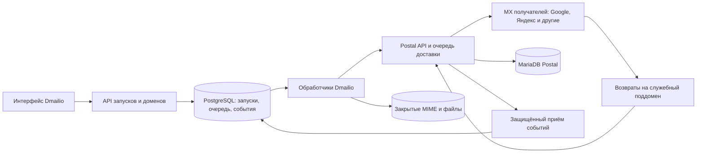

# Собственная инфраструктура массовой отправки Dmailio — спецификация

Дата: 18.10.2026. Статус: **отложено, только проектирование**.

Документ фиксирует рекомендуемую архитектуру для будущей разработки. Он не разрешает покупку серверов, изменение DNS, развёртывание, подключение доменов или реальные отправки. Текущая работа Dmailio остаётся прежней. Возобновление требует отдельного решения пользователя.

Связанные документы:

- [Техническое задание и этапы приёмки](2026-10-18-owned-mail-infrastructure-tz.md).
- [Спецификация маркетинговых рассылок](2026-10-08-marketing-newsletters-design.md).

## 1. Цель и границы

Пользователь выбирает подтверждённый адрес отправителя своего домена, сохранённое письмо и списки подписчиков на 3 000 / 5 000 / 10 000 контактов. Dmailio запускает рассылку сразу или по расписанию, показывает очередь и результаты по каждому получателю. Письма доставляет наша инфраструктура, без передачи через SMTP личного ящика Яндекса или Google.

Почтовые ящики и обычные входящие могут оставаться у Яндекса/Google. Подтверждение домена для отправки не переносит ящик и не требует замены MX основного домена. Поддомены возвратов получают отдельные записи.

Первый этап — закрытый пилот одного нашего домена, одного IP и одной установки Dmailio. Публичный сервис для сторонних клиентов — отдельный этап. Новые личные кабинеты, биллинг и разграничение организаций этим документом не вводятся. «Рабочая область» ниже означает существующую команду/установку Dmailio; публичный запуск нельзя делать без отдельного проекта изоляции клиентов.

Не входят: собственный Gmail/Яндекс 360 для хранения входящей почты, перенос IMAP, изменение действующего прогрева, автоматическая генерация писем, валидация существования адресов сторонним сервисом (отложенная задача №9).

## 2. Что уже существует

В `outreach/marketing/` есть контакты, списки, импорт, документы писем, редакторы, отправители и `MarketingTransport` для подключённого SMTP. В PostgreSQL уже объявлены `marketing.runs`, `marketing.recipients`, `marketing.events`; наличие таблиц не означает готовый движок массовых запусков.

Текущий `outreach/dispatch.mjs` использует SQLite и лимиты подключённых ящиков. Его SMTP-потолки не переносятся на собственный транспорт и не снимаются с существующего транспорта. Существующие ограничения аутрича, история и сохранение его писем в «Отправленных» сохраняются.

## 3. Рекомендуемый стек

| Задача | Решение | Обоснование / условие |
|---|---|---|
| Управление, редакторы, аудитория | Существующий Dmailio, Node.js | Один интерфейс; отдельная кнопка выбора транспорта |
| Очередь запусков и получателей | Существующий PostgreSQL маркетингового модуля | Транзакции, уникальные задания, блокировки; отдельный Redis в пилоте не нужен |
| Доставка до почтовых серверов получателей | Postal в отдельных Docker-контейнерах | Готовый движок; версия и digest фиксируются после проверки совместимости |
| Собственные данные Postal | Отдельная MariaDB, совместимая с выбранной версией Postal | Не использовать PostgreSQL Dmailio вместо требуемой Postal базы |
| Связь Dmailio → Postal | HTTP API по защищённому каналу | Отправка одного RFC/MIME-письма одному получателю; связь ID обеих систем |
| События доставки | Webhooks Postal + сверка статуса по API | Повторяемые события, задержки, ошибки, поздние возвраты |
| Открытия, клики, файлы по ссылке | Единый слой аналитики Dmailio | Не включать одновременно аналогичную модификацию писем в Postal |
| MIME, картинки, файлы, резервные копии | Закрытое S3-совместимое хранилище | На первом техническом стенде допустим отдельный диск с резервированием; перед пользовательским пилотом подключить object storage |
| TLS и доступ | Reverse proxy, действующие сертификаты, закрытые административные интерфейсы | API Postal не публикуется как свободный SMTP/HTTP relay |
| Мониторинг | Метрики приложения/Postal + Prometheus/Grafana или уже действующий эквивалент | Конкретные инструменты фиксируются при возобновлении; алерты обязательны |

Postal — основное проектное решение, а не уже внедрённая зависимость. Если проверка API, эксплуатационных условий или лицензии не проходит, дальнейшую реализацию остановить и представить замену. Postfix и другие MTA рассматриваются как альтернативы, не как второй одновременно установленный движок.

## 4. Архитектура и владение данными

Dmailio отвечает за аудиторию, согласие/подписку, отписки, выбор отправителя, снимок письма, ограничения пользователя и историю запуска. Postal отвечает за принятые им задания, SMTP-доставку, временные повторы до MX, обработку возвратов и состояние своих очередей. Dmailio не дублирует повторную SMTP-доставку письма, уже принятого Postal.

`accepted` означает принятие Postal в свою очередь. `delivered` означает подтверждённое принятие сервером получателя, а не попадание во «Входящие» и не прочтение. Это различие обязательно в интерфейсе и отчётах.

## 5. Подключение домена и адреса

1. Пользователь указывает домен и корпоративный адрес отправителя; публичные домены, которыми он не управляет, для этого транспорта недоступны.
2. Dmailio выдаёт уникальный TXT для подтверждения владения. Проверка DNS фиксирует время, значение и результат; состояние не выводится из самого факта существования записи.
3. Администратор пилота создаёт sending domain в Postal и получает фактические значения DKIM, Return-Path и других необходимых записей.
4. Dmailio показывает записи, проверяет их и соответствие домена подписи адресу From. Существующую SPF-запись объединяют корректно, не создают вторую SPF-запись и не превышают разрешённую глубину DNS lookup.
5. DMARC должен существовать; политика и alignment проверяются. Нельзя автоматически ослаблять действующий `reject`/`quarantine` ради запуска.
6. Проверяется обратная DNS-запись PTR IP, прямое разрешение имени, SMTP hostname/EHLO и сертификат. Для служебного Return-Path настраивается приём возвратов.
7. После успешной проверки и административного разрешения домен становится доступен для пилотной отправки. При изменении обязательных записей новые передачи приостанавливаются с конкретной причиной; приём поздних событий продолжается.

Все имена вроде `mta.example.com`, `rp.example.com`, `track.example.com` в документации являются примерами. Реальные поддомены выбираются отдельно; записи сейчас не создаются. Основной MX корпоративного домена не менять.

API Postal документирован не для всех административных функций. Пилот использует ручное административное подключение через Postal с явным статусом «Ожидает настройки администратором». До публичного запуска необходим проверенный механизм provisioning, выдачи/ротации ключей и удаления доменов; не предполагать наличие недокументированного API.

## 6. Создание и запуск рассылки

1. Выбор транспорта: `connected_smtp` или `owned_postal`. Автоматического переключения между ними нет.
2. Для `owned_postal` выбираются подтверждённый домен/адрес, Reply-To, письмо и списки.
3. Предварительная проверка показывает число уникальных адресов, исключённых отписками/возвратами, размер письма и ориентировочную длительность. Прогноз использует доступные лимиты; это оценка, не SLA доставки.
4. Запуск фиксирует неизменяемый снимок письма, персонализации, аудитории, адреса отправителя, настроек отслеживания и ссылок. Один адрес встречается в запуске один раз, даже если состоит в нескольких списках. Точная нормализация адресов следует действующему импорту Dmailio.
5. Задания создаются пакетами и обрабатываются по лимитам IP/домена/направления доставки. Перед фактической передачей повторно проверяется актуальная отписка/блокировка адреса.
6. Postal возвращает свои ID. Dmailio сохраняет их вместе с Message-ID, ID запуска и получателя; события пополняют историю.
7. В отчёте видны ожидающие, принятые Postal, принятые сервером получателя, временно задержанные, окончательно отклонённые, возвраты, неопределённые, отменённые, отписки; отдельно открытия/клики.

Пауза прекращает новые передачи Dmailio. Письма, уже принятые Postal, могут продолжить доставку; это явно показывается. Обещать их остановку можно только после проверки поддерживаемых операций удержания/отмены Postal. Возобновление продолжает оставшиеся задания. Отмена не отзываeт уже доставленные письма.

После старта содержание и аудитория снимка не редактируются; для другой версии создаётся новый запуск. Ограничения скорости, пауза и расписание оставшейся очереди можно менять без сброса прогресса. Это правило будущего массового транспорта не меняет существующее редактирование настроек аутрич-кампаний.

## 7. Надёжность и аналитика

- Локальный ключ операции `(runId, recipientId, snapshotVersion)` уникален. Повторное нажатие «Запустить» с тем же ключом возвращает тот же запуск.
- Задание берётся транзакционно с lease и heartbeat; второй обработчик не отправляет его параллельно.
- Если HTTP-ответ Postal потерян после возможного принятия письма, статус — `unknown`. Запрещён слепой повтор отправки, в том числе через другой транспорт. Сначала сверка по поддерживаемым ID/событиям. Если достоверно разрешить неопределённость нельзя, нужна явная ручная операция с предупреждением о возможном дубле.
- Не обещать exactly-once между Dmailio и Postal без подтверждённого протокола идемпотентности. Контракт адаптера должен честно отражать ограничения выбранной версии.
- Webhooks принимаются только по проверенному механизму аутентификации выбранной версии Postal либо через собственный защищённый gateway. Подпись не считать доступной по умолчанию. Ограничить тело, частоту и срок хранения; не доверять присланным произвольным URL.
- События хранятся с исходным типом, payload/hash и временем; повторная доставка не удваивает счётчики. Не предполагать, что у каждого webhook есть уникальный event ID. Определить устойчивый составной ключ и сохранять отдельные реальные попытки доставки.
- События могут прийти раньше API-ответа и не по порядку. Несопоставленные события сохраняются для последующей сверки. Поздний bounce не теряется и не отменяется повтором более раннего `delivered`.
- Для постоянного отсутствия адреса прекращается маркетинговая отправка на него в текущей рабочей области. Временная ошибка или переполненный ящик сами по себе не означают постоянного запрета.
- Отписка действует на последующие маркетинговые отправки текущей рабочей области и проверяется перед каждой передачей. История и основания исключения сохраняются. Изменение правил отписок аутрича требует отдельного решения.
- Обработка жалоб реализуется для реально доступных feedback loop/сигналов. Отсутствие данных о жалобах показывается как «Нет данных», а не ноль.
- Открытие означает загрузку пикселя, клик может быть сканированием ссылки. Просмотр страницы файла / скачивание отличается от прочтения файла. Открытие обычного бинарного вложения достоверно не измеряется.
- Архив массовых писем хранится в Dmailio. Автоматическое копирование всех массовых писем в IMAP «Отправленные» в пилот не входит; интерфейс не должен обещать такую копию. Поведение аутрича остаётся прежним.

## 8. Ограничения и эксплуатация

У собственного транспорта свои лимиты: IP, домен отправителя, адрес отправителя, рабочая область, домен получателя, параллельность и количество байтов. Число писем в секунду — конфигурация с учётом прогрева, ответов MX и измеренной производительности, не способ обойти ограничения получателей.

Пилот начинается с контролируемой небольшой аудитории, подтвердившей подписку. Конкретный график роста объёма утверждается оператором по результатам доставки; фиксированное обещание «через N дней можно отправлять сколько угодно» запрещено. Резкие всплески, высокий bounce rate и жалобы вызывают паузу и уведомление.

Пилот: отдельный VPS с минимумом Postal 2 CPU / 4 ГБ / 25 ГБ; для рабочего запаса ориентир 4 CPU / 8 ГБ / 80–160 ГБ SSD, уточняется измерениями. Не размещать пилот на существующем небольшом production-сервере Dmailio. Сервер Dmailio и Postal имеют независимые ресурсы и жизненный цикл. Единственный узел пилота не обеспечивает высокую доступность.

До аренды письменно подтвердить допустимость маркетинговых рассылок у хостера, исходящий TCP/25, статический IP, управление PTR, тариф трафика и правила abuse. Проверить доступность и историю адреса; отсутствие публичных блокировок не гарантирует хорошую репутацию.

Наблюдаемость: длина и возраст очередей обеих систем, accepted/delivered/bounced/unknown, latency API, повторы, 4xx/5xx по MX, диск MariaDB, хранилище, CPU/RAM, DNS/TLS, доля отписок/жалоб при наличии данных. Дежурный оператор и каналы уведомлений назначаются до пилота.

Настройки пилота: резервирование не реже раза в сутки; целевые RPO ≤24 ч и RTO ≤4 ч, подтверждённые восстановлением. Lease/события и сохранённые ID проверяются после восстановления; возможная потеря последних операций не разрешает слепую повторную отправку. Доступ администратора ограничить, секреты хранить вне Git, ключи ротировать. Базы и S3 закрыть от публичного доступа; приватные файлы выдавать через авторизацию или ограниченные токены.

## 9. Бюджет и измерения

Оценки ниже — проектный резерв на инфраструктуру в рублях за месяц на 18.10.2026, не предложение хостера и не расчёт стоимости разработки.

| Этап | Ориентир | Что не включено |
|---|---:|---|
| Технический стенд | 2–5 тыс. ₽/мес. | Работа инженера, гарантии доставки и отказоустойчивость |
| Закрытый пользовательский пилот | 5–15 тыс. ₽/мес. | Разработка, сопровождение оператором, публичные клиенты |
| Несколько клиентов, разделение ресурсов, запас | 15–50 тыс. ₽/мес. и выше | Фиксированный SLA и стоимость команды; требуется отдельный расчёт |

Расчёт: VPS + IP + диски/объекты + операции хранилища + исходящий трафик + резервные копии + мониторинг + сопровождение. Нужны объём писем/месяц, пиковая скорость, MIME-размер, срок хранения, объём возвратов и срок хранения событий. Данные могут дублироваться в Postal/MariaDB и архиве Dmailio — учитывать обе копии.

Например, 100 000 писем × 100 КБ ≈10 ГБ исходных данных; при 1 МБ ≈100 ГБ. Это не полный расход диска/сети: учитываются SMTP/MIME, базы, индексы, репликация и резервные копии. S3 не ускоряет SMTP-доставку, а решает хранение объектов.

Числа 1/5/10 писем в секунду использовать только в сценариях расчёта и испытаний. Реальные внешние лимиты определяются пилотом. Сроки инженерных работ оцениваются после проверки интеграции; прежние «несколько недель / месяцев» являются предварительными ориентирами, не обязательством.

## 10. Условия перехода к реализации

Нужны отдельное согласование запуска, утверждённый бюджет/владелец эксплуатации, выбранный хостер с SMTP/25/PTR, пилотный домен и тестовые адреса, проверка версии/лицензии Postal, доказанный контракт API и неопределённой отправки, утверждённые правила подписки/отписки и план восстановления. Пока это не выполнено, статус проекта остаётся «Отложено».

## 11. Проверенные источники

Источники прочитаны 18.10.2026; версии, цены и требования перепроверить перед запуском.

- [Postal: prerequisites](https://docs.postalserver.io/getting-started/prerequisites/) — контейнеры, требования к отдельному серверу, MariaDB, порт 25.
- [Postal: API](https://docs.postalserver.io/developer/api/) — отправка MIME/JSON, идентификаторы; ограничения административного API.
- [Postal: webhooks](https://docs.postalserver.io/developer/webhooks/) — доставка, задержки, ошибки и поздние возвраты.
- [Postal: DNS](https://docs.postalserver.io/getting-started/dns-configuration/) — служебные и клиентские записи.
- [Yandex Cloud: public addresses](https://yandex.cloud/en/docs/vpc/concepts/address) — ограничения исходящего порта 25.
- [Selectel: VDS](https://selectel.ru/services/cloud/vps-vds/) — пример опубликованных цен, не подтверждение пригодности для массовой почты.
- [Unisender: выделенный IP](https://www.unisender.com/ru/features/email/dedicated-ip/) — прогрев и ограничения гарантий доставляемости.
